# Clean Home: step-by-step install guide (Windows PC → Samsung TV)

This guide puts **Clean Home**, your ad-free home screen, on your
**Samsung UA43DU7660KLXL** TV (2024, Tizen) using a **Windows 10 or 11** PC.

Follow the parts **in order**, A to J. Each step says exactly what to click, and
**"What you should see"** tells you whether it worked. If something doesn't
match, go to **Part K – Troubleshooting**.

| | Part | Time |
|---|---|---|
| A | Download the project from GitHub | 5 min |
| B | Find the PC's and TV's IP addresses | 5 min |
| C | Turn on Developer Mode on the TV | 5 min |
| D | Install Tizen Studio | 15–30 min |
| E | Add the Samsung TV tools (Package Manager) | 10–20 min |
| F | Open Tizen Studio for the first time | 2 min |
| G | Connect Tizen Studio to the TV | 5 min |
| H | Create your Samsung certificate | 10 min |
| I | Install Clean Home on the TV | 5 min |
| J | Put Clean Home first on the TV's home row | 2 min |
| K | Troubleshooting | |

**Before you start, have ready:**

- The PC and the TV on the **same Wi-Fi / home router**.
- About **8 GB free** on drive C:.
- Your **GitHub** login (account `chaosmanage`).
- A **Samsung account** (email + password). The one you use on a Samsung phone
  or TV works. If you don't have one, create it free at <https://account.samsung.com>.
- Pen and paper for **two things you must not lose**: the certificate password
  (Part H) and the IP addresses (Part B).

> Pictures in this guide come from Samsung's official developer documentation
> (credited under each picture and in "Picture credits" at the end). Samsung's
> pictures may show a different TV model or an older Windows look, but the
> buttons and words are the same. Where no official picture exists, the step
> describes exactly what's on screen.

---

## Part A – Download the project from GitHub

The project is in a **private** GitHub repository, so you must be signed in to see it.

1. Open **Google Chrome** or **Microsoft Edge** on the PC.
2. Go to <https://github.com> and click **Sign in** (top right). Sign in as
   **chaosmanage**.
3. Go to <https://github.com/chaosmanage/samsung-tv-launcher>.

   **What you should see:** a page titled **samsung-tv-launcher** with a list
   of files (`config.xml`, `index.html`, `css`, `js`, `INSTALL.md`, …).
   If you see **"404 – Page not found"**, you are not signed in as chaosmanage.
   Go back to step 2.

4. Click the green **`<> Code`** button (above the file list, on the right).
5. In the box that opens, click **Download ZIP** (the last line).

   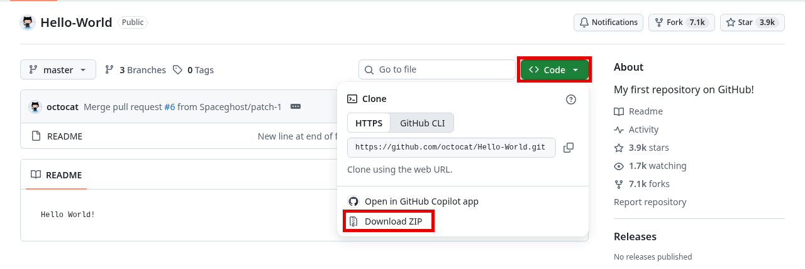
   *The **Code** button and **Download ZIP**, highlighted in red. This picture
   was taken on a public example project; your project's page looks the same,
   with a different name. (Screenshot of github.com, taken Oct 2026.)*

6. The browser downloads a file called **`samsung-tv-launcher-main.zip`** into your
   **Downloads** folder (`C:\Users\<your name>\Downloads`). In Chrome it shows
   at the top right; in Edge, under the download arrow ↓.
7. Make the destination folder: open **File Explorer** (Windows key + E), click
   **This PC** → **Local Disk (C:)**, right-click an empty area →
   **New** → **Folder**, and name it **`TV`**. You now have **`C:\TV`**.
8. In File Explorer open **Downloads**, **right-click**
   `samsung-tv-launcher-main.zip` → **Extract All…**
   (Windows 11: it's in the first menu; if not, click **Show more options** first).
9. In the **Extract Compressed (Zipped) Folders** window, replace the text in
   the box with **`C:\TV`** (or click **Browse…** and pick `C:\TV`). Leave
   **"Show extracted files when complete"** ticked. Click **Extract**.

   **What you should see:** File Explorer opens `C:\TV` with **one folder**,
   **`samsung-tv-launcher-main`**. Open it. Inside you should see
   **`config.xml`**, **`index.html`**, **`icon.png`**, and folders **`css`**,
   **`js`**, **`docs`**.

   > ✅ The correct folder is **`C:\TV\samsung-tv-launcher-main`**, the one that
   > *directly* contains `config.xml`. You'll pick this folder in Part I.
   > If you see a second `samsung-tv-launcher-main` folder inside the first,
   > you extracted somewhere else. Use the inner one (the one containing
   > `config.xml`).

---

## Part B – Find the IP addresses (write both down)

### B1. The PC's IP address

1. Click **Start**, type **`cmd`**, and click **Command Prompt**.
2. In the black window type **`ipconfig`** and press **Enter**.
3. Find the section for the connection you use:
   - Wi-Fi: **"Wireless LAN adapter Wi-Fi:"**
   - Cable: **"Ethernet adapter Ethernet:"**

   Ignore sections whose names contain *vEthernet*, *VirtualBox*, *VMware*,
   *Bluetooth*, or that say *Media disconnected*.
4. In that section, read **IPv4 Address**. It looks like
   `IPv4 Address. . . . . . . . . . . : 192.168.1.23`

   **Write down:** PC IP = `192.168.___.___`

### B2. The TV's IP address

1. On the TV remote press **Home** (🏠), go to **Settings** (⚙ at the bottom
   left of the menu) → **All Settings** → **Connection** → **Network** →
   **Network Status** → **IP Settings**.
2. Read **IP Address**.

   **Write down:** TV IP = `192.168.___.___`

   **What you should see:** the first three groups of numbers are usually
   **the same** as the PC's (for example both start `192.168.1.`). If they're
   completely different, the PC and TV are probably on different networks. Fix
   that first (Part K).

---

## Part C – Turn on Developer Mode on the TV

> **Typing numbers:** if your remote has no number buttons, press the
> **123** button (or the button with coloured dots) to show a number pad on
> screen, then pick the numbers with the arrows and **OK**.

1. Press **Home** (🏠) on the remote. At the top, choose **Apps**.

   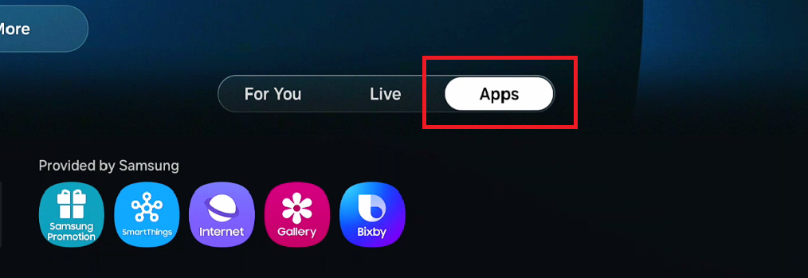
   *Source: Samsung Developer, "TV Device", Figure 1.*

2. Scroll **all the way down** the Apps screen to the **Settings** row and
   open **App Settings**.

   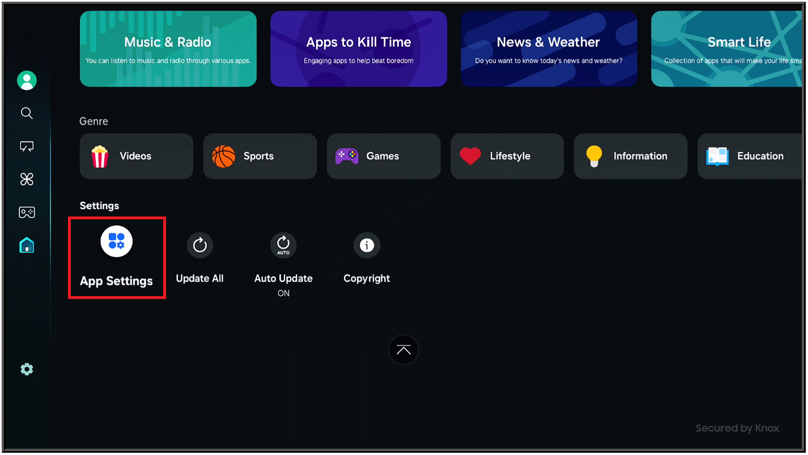
   *Source: Samsung Developer, "TV Device", Figure 2.*

3. **What you should see:** a screen titled **Settings** showing your apps as
   big tiles.

   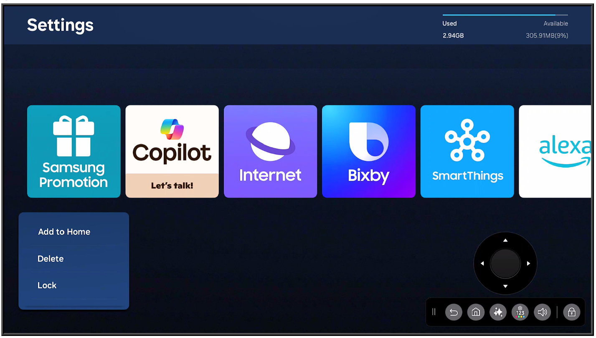
   *Source: Samsung Developer, "TV Device", Figure 3.*

4. On this screen type **1 2 3 4 5** with the remote (number buttons or the
   on-screen pad). Nothing appears while you type; that's normal.
5. **What you should see:** a box with **Developer mode: Off**, two buttons
   **On** / **Off**, and **Host PC IP**.

   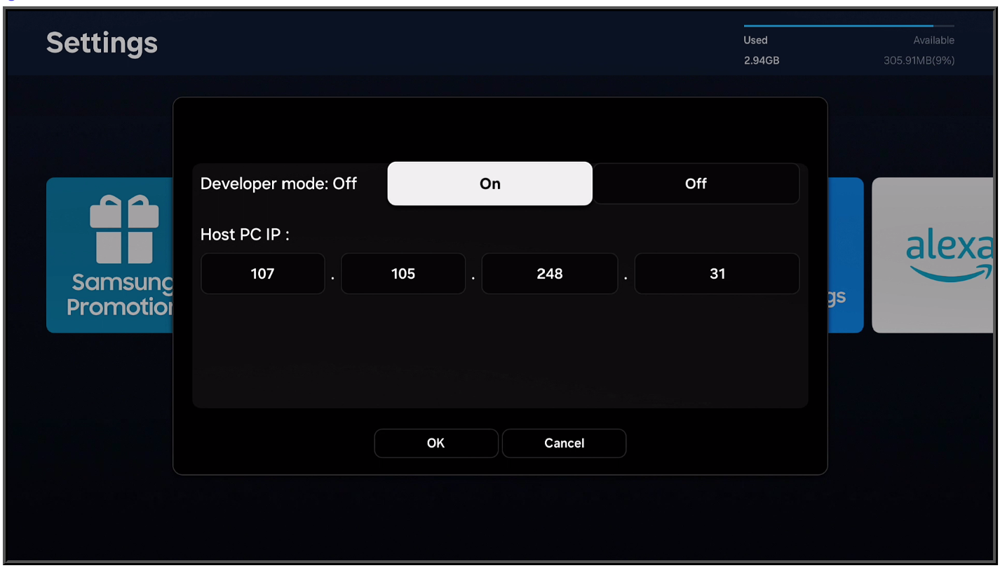
   *Source: Samsung Developer, "TV Device", Figure 4.*

6. Select **On**.
7. Select the four **Host PC IP** boxes and type your **PC IP** from Part B1
   (one number group per box, e.g. `192` `168` `1` `23`).
8. Select **OK**.
9. **What you should see:** an **Information** box saying the TV must be
   restarted, and that you can turn it off by holding the power button for 2
   seconds. Select **Close**.

   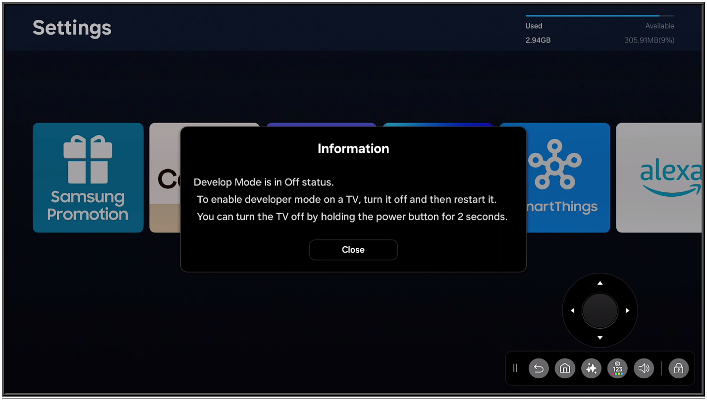
   *Source: Samsung Developer, "TV Device", Figure 5.*

10. **Restart the TV properly:** press and **hold** the **Power** button on
    the remote for about 2–5 seconds, until the screen goes black. Wait 10
    seconds, then press Power again to turn it on. (Or unplug the TV from the
    wall for 30 seconds and plug it back in.)
11. **Check it worked:** go back to **Home → Apps → App Settings** (steps 1–2).

    **What you should see:** the title now reads **Settings (DEVELOP MODE)**.

    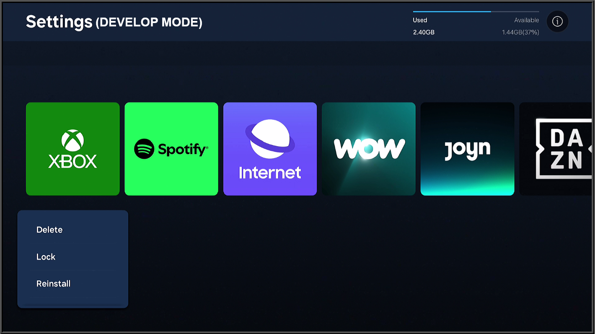
    *Source: Samsung Developer, "TV Device", Figure 6.*

    If it still says just **Settings**, repeat steps 4–10.

Source for this part: [Samsung Developer – TV Device](https://developer.samsung.com/smarttv/develop/getting-started/using-sdk/tv-device.html)

---

## Part D – Install Tizen Studio

You don't need to install Java separately. Tizen Studio has included its own
Java since version 3.7 ([Tizen prerequisites](https://developer.tizen.org/development/tizen-studio/download/prerequisites)).

1. Open your **Downloads** folder and find the installer you downloaded. It
   is named like **`web-ide_Tizen_Studio_6.1_windows-64.exe`** (6.0 is fine
   too). If you don't have it, download it from
   <https://developer.tizen.org/development/tizen-studio/download>
   (Windows, **Tizen Studio … with IDE installer**), or directly from
   <https://download.tizen.org/sdk/Installer/tizen-studio_6.1/web-ide_Tizen_Studio_6.1_windows-64.exe>
   (about 640 MB).
2. **Double-click** the `.exe`.
3. If a blue box says **"Windows protected your PC"** (Microsoft Defender
   SmartScreen): click **More info**, then **Run anyway**.
   If **"Do you want to allow this app to make changes to your device?"** appears, click **Yes**.
4. **License screen:** read it, tick/choose to accept, and click **Accept**.

   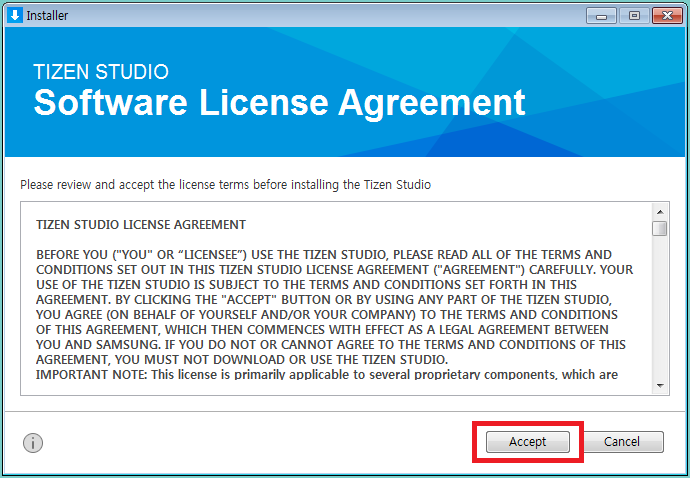
   *Source: Samsung Developer, "Installing TV SDK", Figure 1.*

5. **Installation Settings screen:** two boxes, the SDK location and the
   data location.
   - Set the first to **`C:\tizen-studio`**
   - Set the second to **`C:\tizen-studio-data`**

   (Click the box and type, or use the **…** button.) **Don't** use
   `C:\Program Files`: Tizen tools then need admin rights and misbehave.
   When no red error text is shown, click **Install**.

   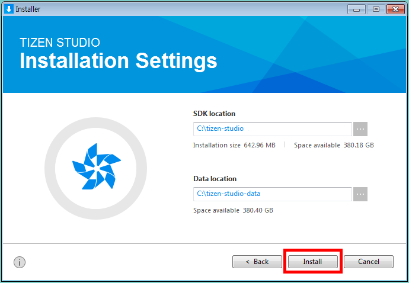
   *Source: Samsung Developer, "Installing TV SDK", Figure 2.*

6. Wait. It downloads and installs (5–20 minutes depending on your internet).
7. **Last screen:** make sure **"Launch the Package Manager"** is **ticked**,
   then click **Finish**.

   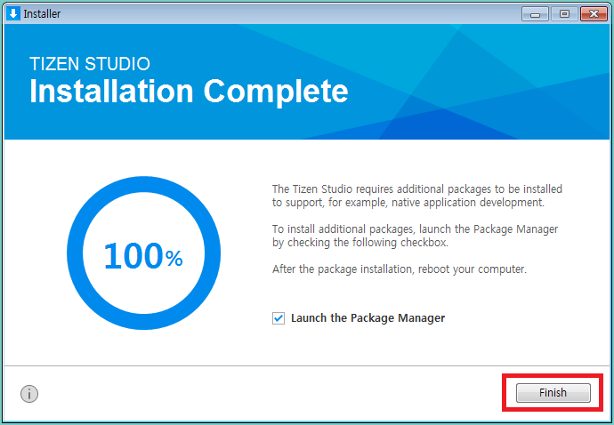
   *Source: Samsung Developer, "Installing TV SDK", Figure 3.*

**What you should see:** the **Package Manager** window opens (blue banner
"TIZEN STUDIO Package Manager"). Continue with Part E.

> If Package Manager did not open, open File Explorer, go to
> **`C:\tizen-studio\package-manager\`** and double-click
> **`package-manager.exe`**.

Source: [Samsung Developer – Installing TV SDK](https://developer.samsung.com/smarttv/develop/getting-started/setting-up-sdk/installing-tv-sdk.html)

---

## Part E – Add the Samsung TV tools (Package Manager)

> Package Manager shows a warning: *"Please make sure Tizen IDE and Tools are
> closed before Installation"*. Keep Tizen Studio closed during this part.

1. In Package Manager you see three tabs: **Main SDK**, **Extension SDK**,
   **Progress**.

   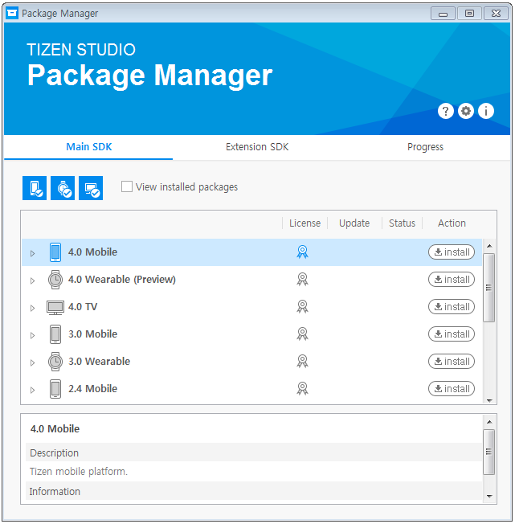
   *Source: Samsung Developer, "Installing TV SDK", Figure 4.*

2. **Main SDK tab (check only):** find **Tizen SDK tools**. Its button
   should say **uninstall** or show as installed. That's correct: the
   installer already added it. If it says **install**, click **install**,
   accept the license, and wait.
3. Click the **Extension SDK** tab.

   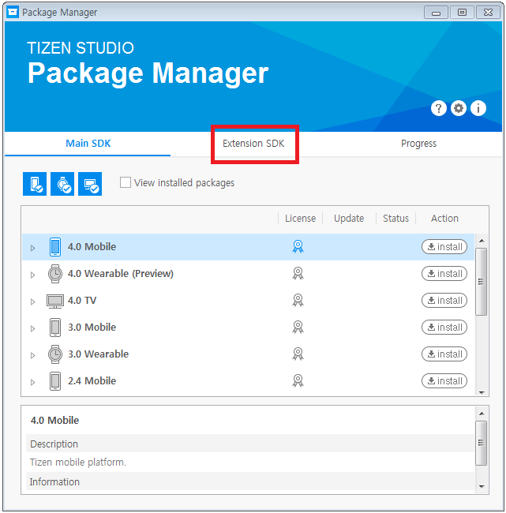
   *Source: Samsung Developer, "Installing TV SDK", Figure 5.*

4. Under **Extras**, click **install** next to **both**:
   - **TV Extensions-9.0** (the name ends with a version number; pick the
     **highest** number listed. On current versions this is 9.0)
   - **Samsung Certificate Extension**

   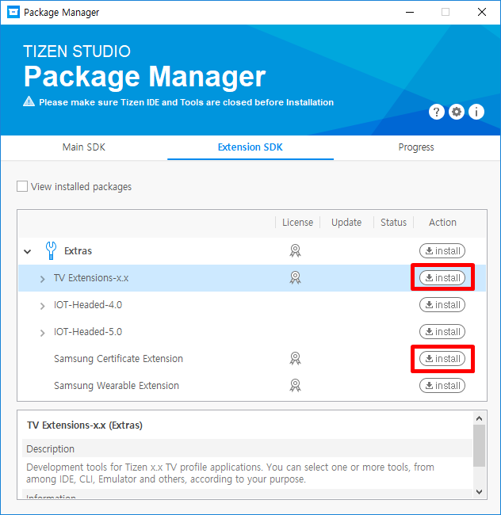
   *The two **install** buttons to click (red boxes). The picture shows
   "TV Extensions-x.x"; yours shows a real number. Source: Samsung
   Developer, "Installing TV SDK", Figure 6.*

5. A license window appears. Click **Accept All**.
6. Wait. The **Progress** tab shows the download. TV Extensions is large (over 1 GB),
   so this can take 10–30 minutes.

   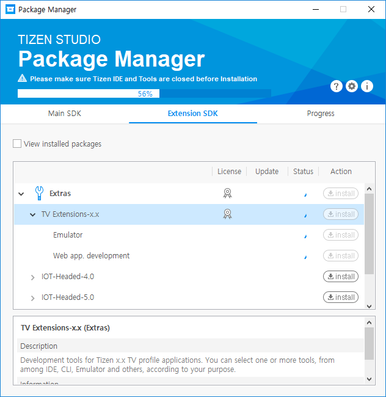
   *Source: Samsung Developer, "Installing TV SDK", Figure 7.*

7. **What you should see when done:** in the Extension SDK tab, both lines
   now have an **uninstall** button (or an **update** button). If
   **Samsung Certificate Extension** shows **update**, click it: Samsung says
   versions older than **2.0.73** can no longer create certificates after
   September 2025.
8. Close Package Manager.

---

## Part F – Open Tizen Studio for the first time

1. Open Tizen Studio either way:
   - **Start** → type **Tizen Studio** → click it, **or**
   - File Explorer → **`C:\tizen-studio\ide\`** → double-click **`TizenStudio.exe`**.
2. If **"Windows protected your PC"** appears: **More info** → **Run anyway**.
3. A window **"Select a directory as workspace"** appears. Type
   **`C:\TV\workspace`** and click **Launch**. (Optionally tick "Use this as
   the default".)
4. If a **Windows Security Alert** says *"Windows Defender Firewall has
   blocked some features of this app"* (for *Java/OpenJDK Platform binary*,
   *sdb*, or *Tizen Studio*): tick **Private networks**, then click **Allow access**.
5. A **Welcome** page may show. Close the **Welcome** tab (× on the tab).

**What you should see:** the main Tizen Studio window, with a menu bar
**File, Edit, …, Tools, Window, Help** and an empty **Project Explorer** on the left.

---

## Part G – Connect Tizen Studio to the TV

The TV must be **on**, and showing **Develop Mode** (Part C step 11).

1. In Tizen Studio click **Tools** → **Device Manager**.

   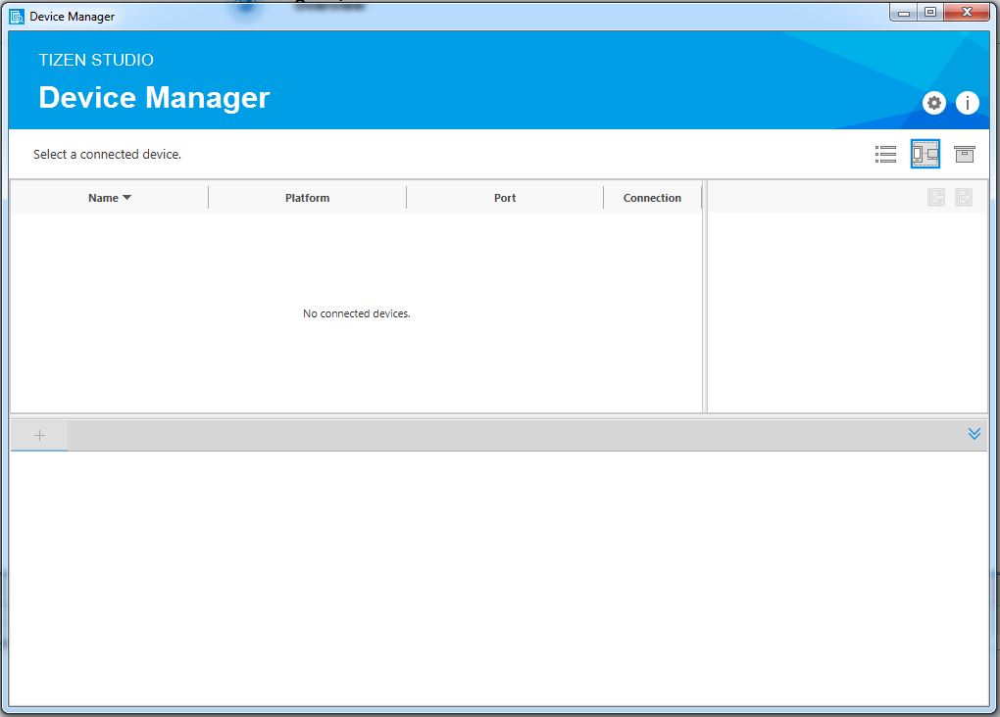
   *Source: Samsung Developer, "TV Device", Figure 5.*

2. In Device Manager click the **Remote Device Manager** icon (top right,
   the phone-and-monitor icon), then click **+** in the small window.

   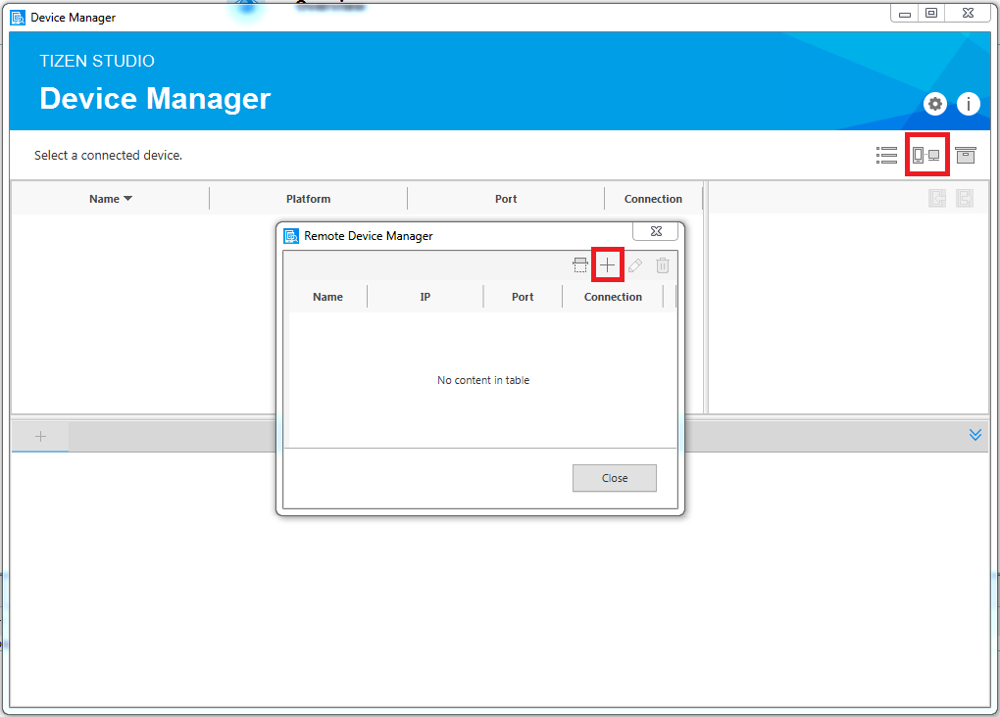
   *Source: Samsung Developer, "TV Device", Figure 6.*

3. In **Add Device** fill in:
   - **Name:** `MyTV`
   - **IP:** your **TV IP** from Part B2
   - **Port:** `26101` (leave as is)

   Click **Add**.

   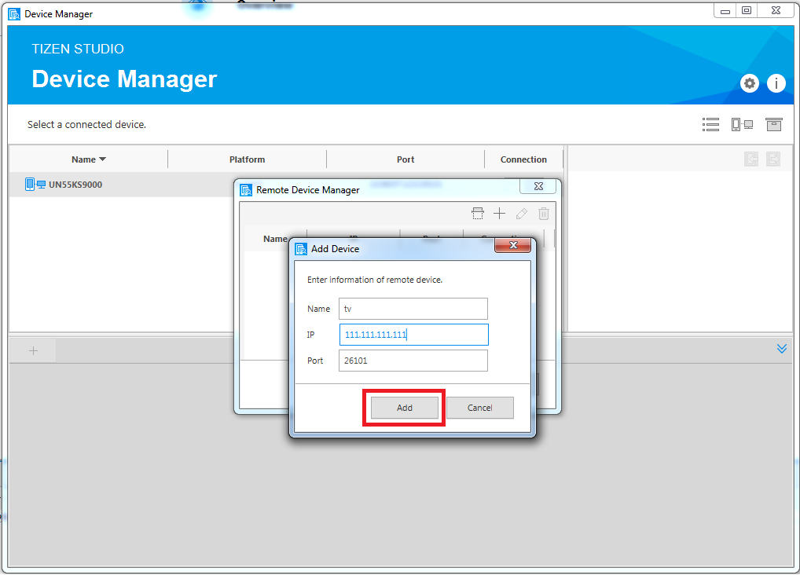
   *Source: Samsung Developer, "TV Device", Figure 7.*

4. In the Remote Device Manager list, switch **Connection** for MyTV to **On**.

   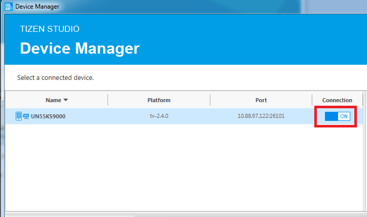
   *Source: Samsung Developer, "TV Device", Figure 8.*

5. If a Windows firewall alert appears now, tick **Private networks** →
   **Allow access**.
6. Click **Close** on the small Remote Device Manager window.

**What you should see:** in the Device Manager main list a line with your TV's
model name (for example **UA43DU7660KLXL** or similar) and the TV's IP with
`:26101`. That means it is connected. **Keep Device Manager open** (you need
it in Part H and I).

If the switch flips back to Off or nothing appears, see Part K, "Can't connect".

---

## Part H – Create your Samsung certificate

Samsung only lets your own apps run on TVs listed in your certificate. This
part makes that certificate and puts your TV in it.

> 📝 You will choose a **password**. **Write it on paper now.** If you lose it,
> you'll have to make a new certificate and reinstall the app.

1. In Tizen Studio click **Tools** → **Certificate Manager**.

   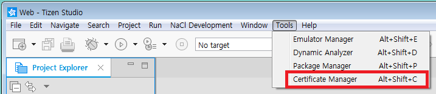
   *Source: Samsung Developer, "Creating Certificates", Figure 1.*

2. If a **"Migration for Certificate Profile"** box appears, click **Cancel**.

   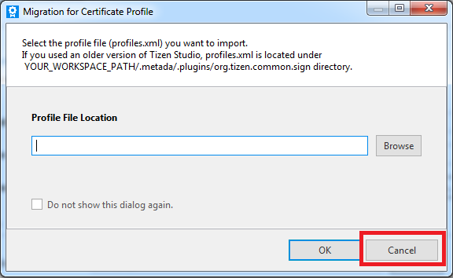
   *Source: Samsung Developer, "Creating Certificates", Figure 2.*

3. Click the **+** button to create a new profile.

   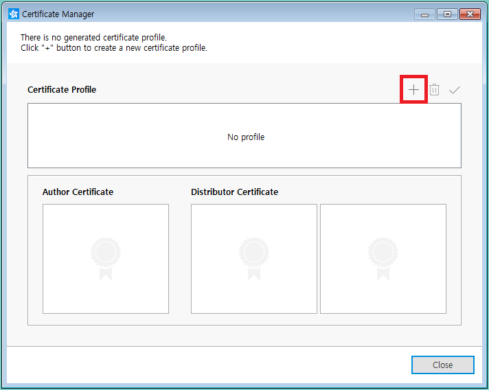
   *Source: Samsung Developer, "Creating Certificates", Figure 3.*

4. Choose **Samsung** (not Tizen).

   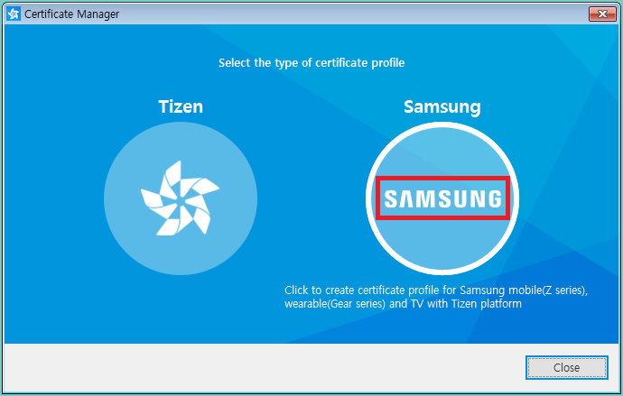
   *Source: Samsung Developer, "Creating Certificates", Figure 4.*

5. Choose **TV** → **Next**.

   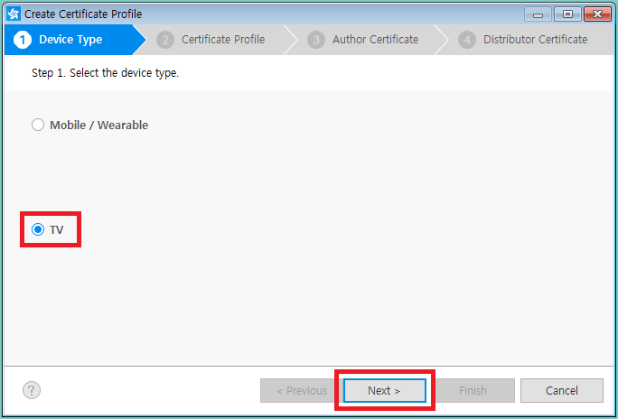
   *Source: Samsung Developer, "Creating Certificates", Figure 5.*

6. **Certificate profile name:** type **`MyTV`** → **Next**.

   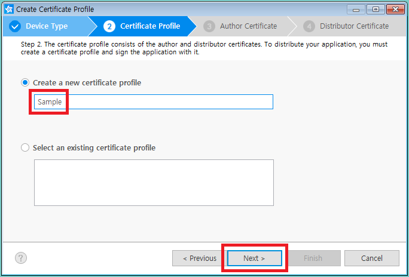
   *Source: Samsung Developer, "Creating Certificates", Figure 6.*

7. Choose **Create a new author certificate** → **Next**.

   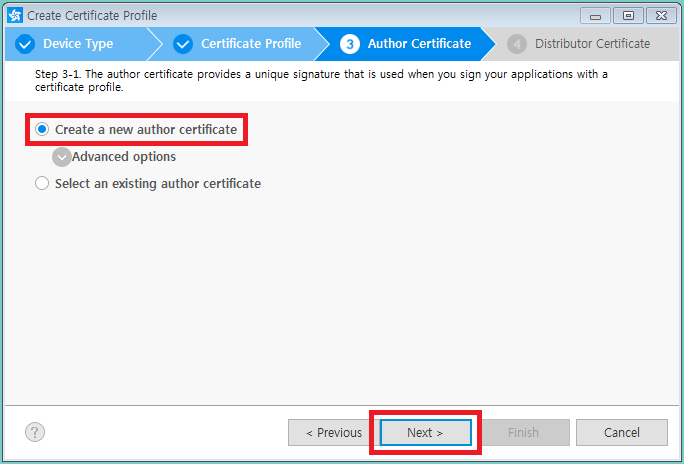
   *Source: Samsung Developer, "Creating Certificates", Figure 7.*

8. Fill in:
   - **Author name:** your name, e.g. `Kunal`
   - **Password** and **Confirm password:** choose one and **write it down**
   - Leave **"Apply the same password for the distributor certificate"** ticked

   Click **Next**.

   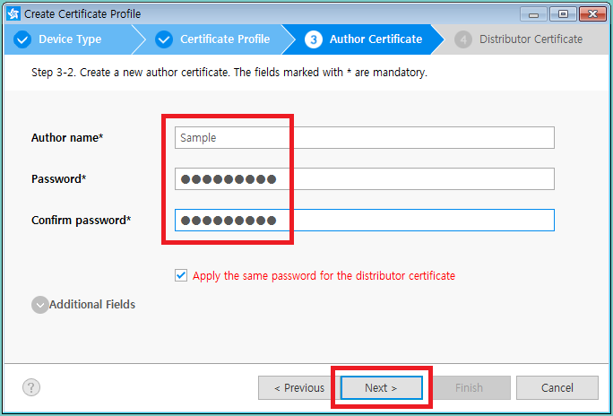
   *Source: Samsung Developer, "Creating Certificates", Figure 8.*

9. A **Samsung account sign-in** window opens. Sign in with your Samsung
   account email and password (approve any phone/email verification).

   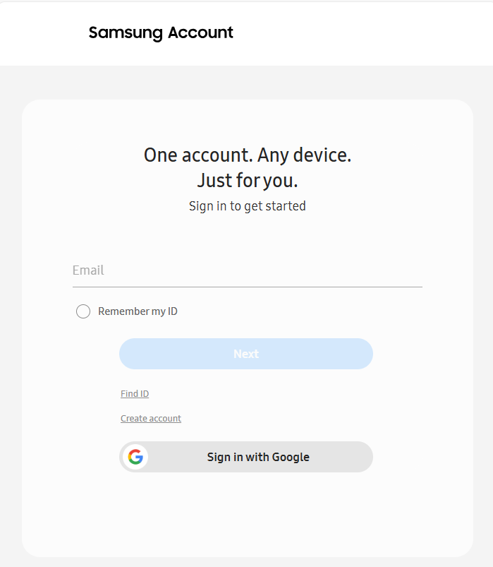
   *Source: Samsung Developer, "Creating Certificates", Figure 9.*

10. **Backup location:** leave the suggested folder (it's inside
    `C:\tizen-studio-data\keystore`) → **Next**.

    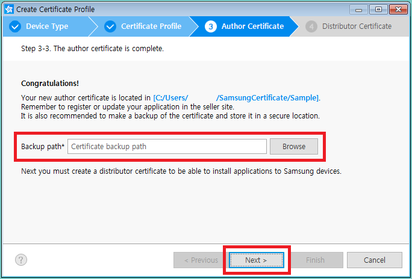
    *Source: Samsung Developer, "Creating Certificates", Figure 10.*

11. Choose **Create a new distributor certificate** → **Next**.

    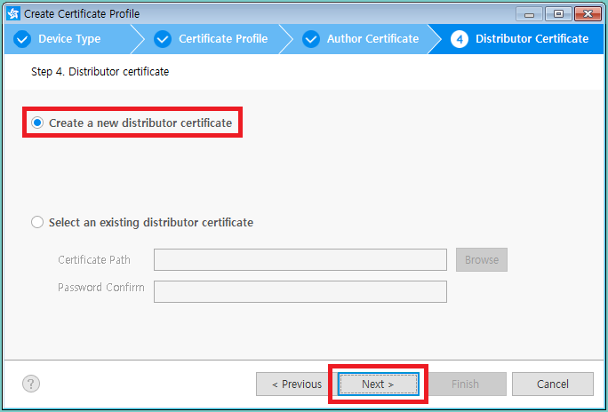
    *Source: Samsung Developer, "Creating Certificates", Figure 13.*

12. On the **Distributor Certificate** page:
    - **Privilege:** choose **Public**
    - Under **Add individual DUIDs**, your connected TV's ID (a long code,
      the DUID) should already be filled in, because Device Manager is connected. If the first
      box is empty, click the **+** next to it to add the connected TV.
      Do **not** type anything else.

    Click **Next**.

    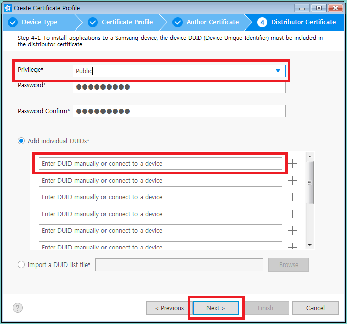
    *Privilege **Public**, and the DUID box (red boxes). In your window the
    DUID box should contain your TV's code. Source: Samsung Developer,
    "Creating Certificates", Figure 14.*

    > If the DUID box stays empty: close the wizard (Cancel), make sure Device
    > Manager shows the TV connected (Part G), and start Part H again.

13. Click **Finish**.

    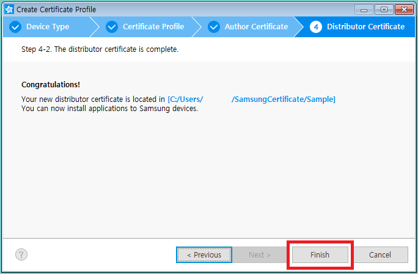
    *Source: Samsung Developer, "Creating Certificates", Figure 15.*

14. **What you should see:** back in Certificate Manager, **MyTV** in the list,
    with a **tick / "active"** mark. If another profile is active, click
    **MyTV** and set it as active (the check-mark icon). Close Certificate Manager.

Source: [Samsung Developer – Creating Certificates](https://developer.samsung.com/smarttv/develop/getting-started/setting-up-sdk/creating-certificates.html)

---

## Part I – Install Clean Home on the TV

### I1. Allow installs from this PC (do this once)

1. Go to **Device Manager** (Tools → Device Manager if you closed it).
2. **Right-click** your TV in the list → **Permit to install applications**.

   **What you should see:** a short success message, or nothing. Both are
   fine. (If you get an error but installation later works, ignore it.)

### I2. Bring the project into Tizen Studio

1. In Tizen Studio click **File** → **Import…**
2. Open **General**, choose **Existing Projects into Workspace** → **Next**.
3. Select **Select root directory**, click **Browse…**, choose
   **`C:\TV\samsung-tv-launcher-main`** (the folder with `config.xml`) → **Select Folder**.
4. **What you should see:** under **Projects**, **CleanHome** appears, ticked.
   Leave **"Copy projects into workspace"** **unticked**. Click **Finish**.
5. **CleanHome** now appears in **Project Explorer** on the left.

> If **No projects are found**, see Part K, "Import finds no project".

### I3. Install and run

1. Check the TV is still connected (Device Manager shows it).
2. In **Project Explorer**, **right-click CleanHome** → **Run As** →
   **Tizen Web Application**.
3. If asked to choose a device, choose your TV.
4. Wait 10–30 seconds. The **Console** at the bottom shows progress, ending with
   lines like *"Installing the package…"*, *"… install completed"*,
   *"Launching the Tizen application…"*.

**What you should see on the TV:** the **Clean Home** screen opens: a dark
screen with a greeting and clock at the top and 8 big tiles (**HDMI,
YouTube, Netflix, ZEE5, Prime Video, JioHotstar, Sony LIV, Internet**).
Use the arrows and **OK** to try it. 🎉

You can now close Tizen Studio. Clean Home stays installed on the TV.

---

## Part J – Put Clean Home first on the TV's home row

1. Press **Home** (🏠) → **Apps** → scroll to the bottom → **App Settings**
   (same screen as Part C step 3).
2. Highlight **Clean Home**, press **Down** on the remote, choose
   **Add to Home** (if you only see Delete/Lock, it's already on Home).
3. Press **Home** (🏠). In the row of apps, highlight **Clean Home**, press
   **Down**, choose **Move**, press **Left** until it's in the **first
   position**, and press **OK**.

**What you should see:** from now on, **Home → OK** (or Home, then the first
app) opens Clean Home.

Tip: for extra privacy, also go to **Settings → All Settings → General & Privacy
→ Terms & Privacy** and switch off **Internet Based Advertisement** and
**Viewing Information Services**.

---

## Part K – Troubleshooting

| Problem / message | Why it happens | What to do |
|---|---|---|
| GitHub shows **404** | Not signed in as chaosmanage (the project is private) | Sign in as chaosmanage, open the link again (Part A). |
| **Can't connect** / TV not in Device Manager / Connection switch turns off | Developer Mode off, wrong IP, different network, or PC IP changed | 1) Check **Settings (DEVELOP MODE)** on the TV (Part C step 11). 2) Run `ipconfig` again: if the PC IP changed, re-enter it on the TV (Part C steps 4–10). 3) Check the TV IP (Part B2) matches what you typed in **Add Device**. 4) Both must be on the same router (not one on a guest Wi-Fi). 5) Restart the TV (hold Power). |
| **Developer Mode turned off** or "Develop Mode" missing after a restart / power cut | The TV sometimes resets it, or the PC got a new IP from the router | Redo Part C steps 1–11 with the current PC IP. The app stays installed. |
| Windows **firewall** prompt, or connection blocked | Windows Defender Firewall | Click **Allow access** with **Private networks** ticked. If you missed it: Start → **Windows Security** → **Firewall & network protection** → **Allow an app through firewall** → **Change settings** → tick **Private** for *OpenJDK/Java Platform binary* and *sdb*. Also make sure your Wi-Fi is set to **Private** network (Settings → Network & internet → Wi-Fi → your network → **Private network**). |
| **"Windows protected your PC"** | SmartScreen doesn't know the installer | **More info** → **Run anyway**. |
| DUID box empty in Part H | TV not connected while creating the certificate | Connect first (Part G), then redo Part H. |
| **Certificate / DUID mismatch**, e.g. *"install failed[118 …] Check certificate error"* | Certificate made without this TV's DUID, a **Tizen** (not Samsung) profile is active, or the wrong profile is active | Certificate Manager: make sure **MyTV** (type Samsung, TV) is **active**. If unsure, delete it and redo Part H with the TV connected. Then Part I1 (**Permit to install applications**) and I3 again. |
| *"install failed[118, -12] … Invalid signature. Signed with wrong key…"* | App was signed with a different certificate than a copy already on the TV, or files changed after signing | On the TV: Apps → App Settings → Clean Home → Down → **Delete**. Then Part I1 and I3 again. |
| *"install failed[118, -11]"* or a plain *"install failed[118]"* | General install refusal. Usually the same certificate causes as above, or *Permit to install* not done | Do Part I1, check **MyTV** is active, delete any old Clean Home from the TV, try I3 again. If it still fails, redo Part H choosing **Privilege: Partner** instead of Public, then I1 + I3. |
| *"1010 : App install fail"* | Usually certificate problems (Samsung's list) | Same as the certificate rows above. |
| *"1013 : App run fail"* | Installed, but the TV couldn't open it this time | Open Clean Home from the TV's Apps, or restart the TV. |
| **Import finds no project** (Part I2) | Hidden project files (`.project`) missing from the download | Make a fresh project and copy the files in: **File → New → Tizen Project** → **Template** → **TV-Samsung** (highest version) → **Web Application** → **Basic Project** → name **CleanHome** → **Finish**. Then, in File Explorer, copy **everything** from `C:\TV\samsung-tv-launcher-main` into `C:\TV\workspace\CleanHome` and choose **Replace the files in the destination**. In Tizen Studio right-click CleanHome → **Refresh**, then Part I3. |
| Package Manager won't open | Damaged first-run settings | Close it, delete the folder `C:\Users\<your name>\.package-manager`, and run `C:\tizen-studio\package-manager\package-manager.exe` again. |
| A Clean Home tile says *"Couldn't open …"* | That app isn't installed on the TV, or uses a different ID | Install the app from Samsung's Apps store. If it still fails, press **Blue** in Clean Home, note the app's ID, and send it to whoever maintains the project. |

---

## Picture credits

- Developer Mode on the TV (`docs/img/c1`–`c6`) and Device Manager (`g1`–`g4`):
  Samsung Developer, **TV Device**,
  <https://developer.samsung.com/smarttv/develop/getting-started/using-sdk/tv-device.html>
- Installer (`d1`–`d3`) and Package Manager (`e1`–`e4`): Samsung Developer,
  **Installing TV SDK**,
  <https://developer.samsung.com/smarttv/develop/getting-started/setting-up-sdk/installing-tv-sdk.html>
- Certificate Manager (`h01`–`h13`): Samsung Developer, **Creating
  Certificates**,
  <https://developer.samsung.com/smarttv/develop/getting-started/setting-up-sdk/creating-certificates.html>
- GitHub (`a2`): screenshot of github.com (public example repository
  octocat/Hello-World), red boxes added. Taken October 2026.

All Samsung images © Samsung Electronics, reproduced from Samsung's developer
documentation for instructional purposes.

## Sources

- Samsung Developer – Installing TV SDK; TV Device; Creating Certificates (links above)
- Samsung Developer – TV Extension release history (TV Extensions 9.0, Jan 2025):
  <https://developer.samsung.com/smarttv/develop/tools/tv-extension/release-history.html>
- Tizen – Prerequisites (no Java needed since Tizen Studio 3.7):
  <https://developer.tizen.org/development/tizen-studio/download/prerequisites>
- Tizen installer downloads: <https://download.tizen.org/sdk/Installer/>
- Tizen Studio 6.0 release notes (Windows 11 support; avoid admin-only folders):
  <https://docs.tizen.org/application/tizen-studio/release-notes/6-0-release-notes/>
- "Permit to install applications" and certificate errors: Samsung Developer
  FAQ <https://developer.samsung.com/tizen/Smart-TV/FAQ/Tizen-baseline-SDK.html>;
  Stack Overflow <https://stackoverflow.com/questions/74192274>
