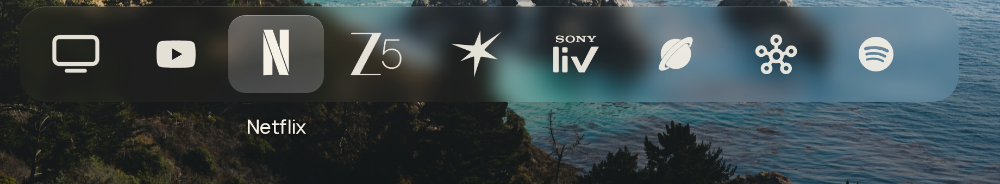

# Clean Home

A quiet, CleanFrame-style home screen for Kunal's Samsung Crystal UHD TV (`UA43DU7660KLXL`, Tizen, 2024).
Based on **[CleanFrame](https://github.com/nthnclrk/CleanFrame) by Nathan Clark** (MIT License). It keeps
CleanFrame's screens, glass dock, typography and remote navigation, adapted for this TV's apps.

Current version: **1.2.3** (see [docs/CHANGELOG-1.2.3.md](docs/CHANGELOG-1.2.3.md) and the live-TV
[test table](docs/TEST-TABLE-1.2.3.md)).



## What you get

- **Dock (default order):** HDMI, YouTube, Netflix, ZEE5, Prime Video, JioHotstar, Sony LIV, Internet.
  Every app has the same slot size and spacing. Known apps use CleanFrame-style **single-ink marks**
  (white, mask-rendered, optically sized with `assets/icons/metrics.js`). Any other app you add uses
  the TV's own `iconPath` in the same slot, or a monogram if the TV only has the Tizen placeholder.
- **Header (top right):** Samsung Home, All apps, Settings.
  - *Samsung Home* opens the stock Smart Hub (`com.samsung.tv.csfs`, then `org.tizen.menu` / `edenview`).
  - *All apps* lists every launchable installed app (via `tizen.application.getAppsInfo`).
  - *Settings* covers background, layout, typography, focus, **Apps on Home** (the app picker) and Samsung shortcuts.
- **App picker** (Settings → Apps on Home): add, remove and reorder up to 9 apps from every installed app.
  It's saved in one small `localStorage` key (`cleanhome.home.v1`).
- **Clock and weather** for **Wakad, Pune** (Open-Meteo, no API key), e.g. `7:16 PM · 29° Clear night · Wakad, Pune`.
- **One wallpaper everywhere:** today's **Bing photo** (default) or a bundled wallpaper. The same image
  feeds the home photo, the dock glass, the Settings / All apps backdrop and every glass field. Glass is a
  live CSS blur of that same image. The Bing image is a live URL and is never written to the TV.
- **HDMI** opens `org.tizen.tv-viewer` (verified STATUS_FOCUS). Art Mode isn't offered (this Crystal UHD has none).
- **Home key behaviour:** pressing Home while in All apps or other sub-screens returns to the main home when the TV
  delivers a launch/resume event. **Known limitation (UA43DU7660 / 2024 firmware):** if Clean Home is already in the
  foreground, pressing Home inside **Settings** may do nothing—the TV does not send an event the page can intercept.
  Use Back, or the header **Samsung Home** control. See [docs/TEST-TABLE-1.2.3.md](docs/TEST-TABLE-1.2.3.md).
- Remote: arrows, OK and Back only.

## Install

See **[INSTALL.md](INSTALL.md)**: Windows, Tizen Studio, `sdb`, signing with your `MyTV` certificate
profile, install/upgrade, optional Home-button takeover, and restore.

App identity (keep stable for in-place upgrades): application ID `KsHome0001.CleanHome`, package `KsHome0001`.

## Develop

```sh
npm ci
npm run dev            # browser preview (app launches need the TV)
npm run check          # syntax + bundle/asset invariants (scripts/check.py)
python3 scripts/make-mono-marks.py   # regenerate single-ink marks from assets/icons/dock/*.png
```

Debug beacon: set `CH_DEBUG_URL` in `app/main.js` (empty in releases) and run
`scripts/windows/chdebug_server.py` on the PC. The TV then POSTs state (view, wallpaper layers, marks,
header, caption) and polls `/cmd` for test commands (`settings`, `apps`, `bing`, `bundled`, `shome`, `internet`, `ping`).

## Attribution and license

- CleanFrame © 2026 Nathan Clark, MIT. See `LICENSE` and `THIRD_PARTY_NOTICES.md`.
- Brand marks (all single-ink white, see `docs/ICON-SOURCES.md`): YouTube / Netflix / Prime Video / Spotify from CleanFrame's
  Simple Icons set; Sony LIV = Simple Icons Sony wordmark + vector liv mark; JioHotstar star rebuilt from the official 2025
  logo (Wikimedia Commons, 3027px); Samsung Internet keyed from the official 2025 SVG (Commons); SmartThings = official 2024
  icon glyph (Commons SVG); ZEE5 and HDMI from bundled 512px artwork. All trademarks belong to their owners and are used only to identify the apps.
- Adaptation: Clean Home for Kunal S / chaosmanage. MIT, same as CleanFrame. Keep Nathan Clark's copyright notice.
