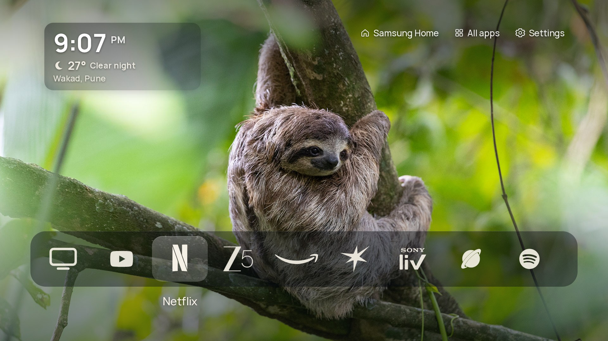
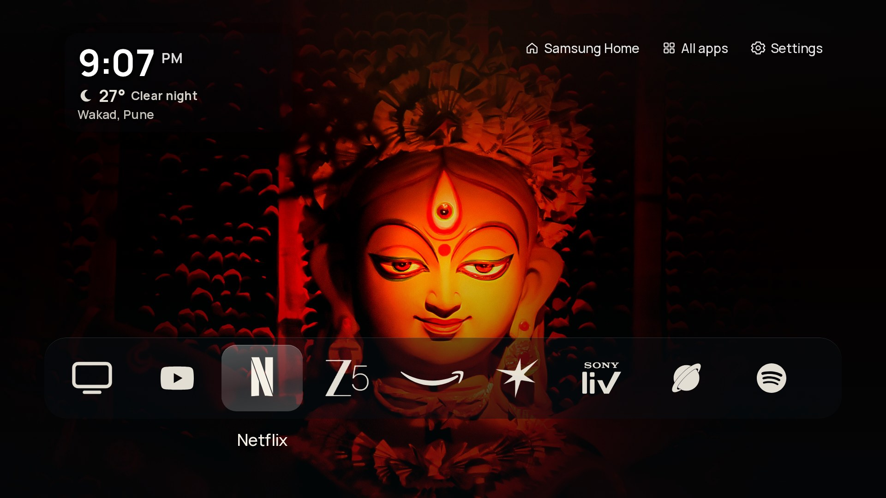
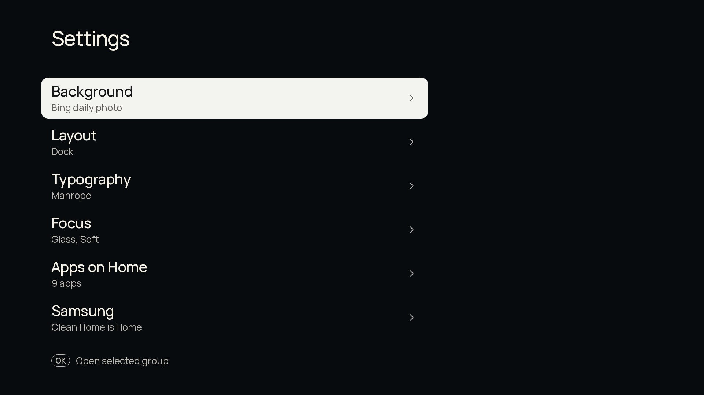
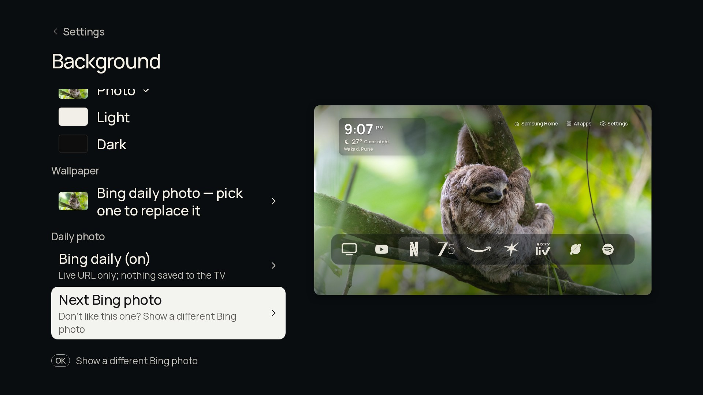
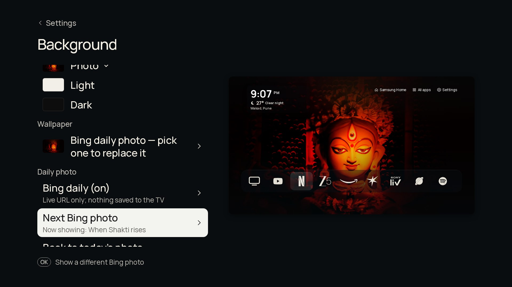
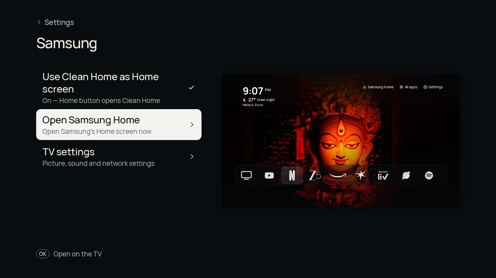
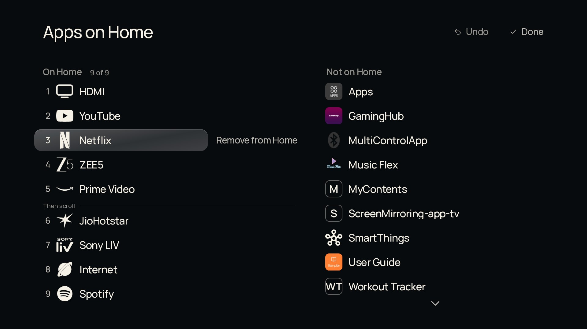
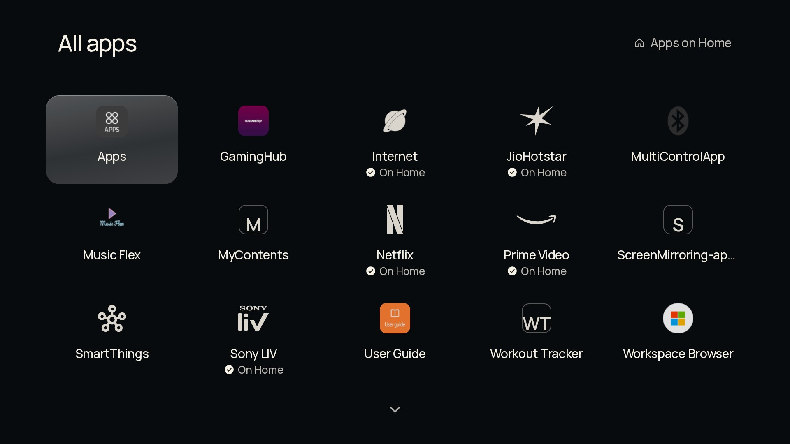

# Clean Home

**A quiet, ad-free home screen for Samsung Tizen TVs.** Version **1.2.7**.

Clean Home (`KsHome0001.CleanHome`) replaces Samsung's busy, ad-filled Smart Hub with a calm full-screen
photo, a clock with local weather, and a single glass dock of the apps you actually use. It's built for
(and tested on) a Samsung Crystal UHD **UA43DU7660KLXL** (2024, Tizen 9.0, ARMv7) driven by a basic remote
with **only arrows, OK, Back and Home** (no number keys, no colour keys).

It's a fork of **[CleanFrame](https://github.com/nthnclrk/CleanFrame) by Nathan Clark** (MIT), adapted for
this TV, its apps and Indian streaming services.



---

## Contents

- [Features](#features)
- [Screenshots](#screenshots)
- [Install (first time)](#install-first-time)
- [Update to a new version](#update-to-a-new-version)
- [Using it with the remote](#using-it-with-the-remote)
- [The Bing wallpaper](#the-bing-wallpaper)
- [Making the Home button open Clean Home](#making-the-home-button-open-clean-home)
- [Restore the original Samsung Home](#restore-the-original-samsung-home)
- [FAQ and troubleshooting](#faq-and-troubleshooting)
- [Project layout](#project-layout)
- [Credits and license](#credits-and-license)

---

## Features

| | |
|---|---|
| **Ad-free glass dock** | Up to 9 apps in one row with equal spacing. Default: HDMI, YouTube, Netflix, ZEE5, Prime Video, JioHotstar, Sony LIV, Samsung Internet (plus anything you add, e.g. Spotify). |
| **Real, crisp logos** | Known apps use single-ink white marks drawn from official artwork (see [docs/ICON-SOURCES.md](docs/ICON-SOURCES.md)). Any other app uses the TV's own icon, or a clean monogram if the TV only has a placeholder. |
| **Focused app name** | While you move along the dock, the focused app's name shows under it (CleanFrame style). |
| **Bing photo of the day** | Today's Bing image (1920×1080, `en-IN`) is the wallpaper everywhere. It refreshes automatically when the date changes. |
| **Next Bing photo** *(new in 1.2.5)* | Don't like today's photo? **Settings → Background → Next Bing photo** shows a different recent Bing image. **Back to today's photo** undoes it. |
| **Bundled wallpapers** | Offline-safe photos in the app (Misty coast, Quiet cove, Forest mist, Bridge at dusk, Golden hour, ...), with optional rotation (each time Home opens, every 5 / 15 / 60 minutes). |
| **Clock + weather** | Big white clock with AM/PM and the current weather for **Wakad, Pune** from [Open-Meteo](https://open-meteo.com) (no API key, refreshed every 15 minutes). |
| **Header** | Top right: **Samsung Home**, **All apps**, **Settings**. Samsung Home opens the stock Smart Hub whenever you need it. |
| **All apps** | Every launchable installed app with its icon; apps already on the dock are marked *On Home*. |
| **App picker** | **Settings → Apps on Home**: add, remove and reorder dock apps from everything installed. |
| **Use Clean Home as Home screen** | **Settings → Samsung**: one toggle. On = the remote's Home button opens Clean Home. Off = Home goes straight to Samsung Home (Clean Home stays black for that moment and hands off, so there's no flash). Clean Home always opens from the Apps list either way, so you can never get locked out. |
| **Home always returns to the main screen** | Pressing Home inside Settings, All apps or any sub-screen brings you back to the main screen. |
| **Back does nothing on the main screen** | No "Leave Home?" prompt; Back only goes up one level inside Settings and lists. |
| **Fast on ARMv7** | Solid translucent glass (no live blur), coalesced key repeat, nothing written to disk except a few small `localStorage` keys. |
| **No bloat** | Bing images and weather are live URLs. Nothing is downloaded to the TV's storage; only the chosen photo URL is remembered. |

## Screenshots

All screenshots are rendered at 1920×1080 from this repository in headless Chromium
(`node scripts/_screenshots.mjs`), with today's live Bing photo. On the TV it looks the same.

| Main screen (focused app name under the dock) | After **Next Bing photo** |
|---|---|
|  |  |
| **Settings** | **Settings → Background** with *Next Bing photo* |
|  |  |
| **Next Bing photo applied (preview on the right)** | **Settings → Samsung** (Use Clean Home as Home screen) |
|  |  |
| **Settings → Apps on Home** (app picker) | **All apps** |
|  |  |

## Install (first time)

Full step-by-step guide: **[docs/INSTALL.md](docs/INSTALL.md)**. In short, on a Windows PC on the same Wi-Fi/LAN as the TV:

1. Install **Tizen Studio** with the **TV Extensions** and **Samsung Certificate Extension**.
2. On the TV: **Apps → 1 2 3 4 5** (on-screen keypad works too) → **Developer mode On** → enter your **PC's IP** → restart the TV.
3. `sdb connect <TV-IP>:26101`.
4. Create a **Samsung TV certificate profile** (e.g. `MyTV`) in Certificate Manager and *Permit to install applications*.
5. Build, sign and install:
   ```bat
   powershell -ExecutionPolicy Bypass -File scripts\windows\build_install.ps1 -Tv <TV-IP>:26101 -Profile MyTV
   ```
6. Open **Clean Home** from the TV's Apps list. Optional: make the Home button open it ([below](#making-the-home-button-open-clean-home)).

## Update to a new version

Full guide: **[docs/UPDATE.md](docs/UPDATE.md)**. In short: `git pull`, then run the same
`build_install.ps1` command. It installs **over** the old version, so your dock, Settings, the
*Use Clean Home as Home screen* toggle and the Home-button takeover all stay. You don't need to re-run
`run.py apply` after a normal update (only after an **uninstall**).

## Using it with the remote

| Key | Main screen | Settings / All apps / pickers |
|---|---|---|
| ← → | Move along the dock (or along the header when you're in it) | Move between choices in a row |
| ↑ ↓ | Move between the dock and the header (Samsung Home · All apps · Settings) | Move between rows |
| OK | Open the focused app / header item | Choose |
| Back | Nothing (stays on Clean Home) | Up one level |
| Home | Clean Home (if the toggle is On) or Samsung Home (Off) | Back to the Clean Home main screen |

## The Bing wallpaper

**How it refreshes**

- On every launch Clean Home asks Bing for today's image (`HPImageArchive.aspx?idx=0&n=1&mkt=en-IN`,
  1920×1080) and checks again **every hour** while it's running. A new image only appears once the
  **date changes** (Bing publishes one per day), so in practice it's a daily refresh, not a fixed 24-hour timer.
- The image is a live URL on an ``; nothing is saved to the TV's storage. Only the chosen URL and
  the date are stored in `localStorage` (`cleanhome.bing`, one small JSON value).
- If Bing can't be reached, the current photo stays. With no photo at all yet, the bundled wallpaper is shown.
  Failed checks are retried after 15 minutes.

**Changing it by hand (1.2.5+)**

1. **Settings → Background**, press ↓ to **Next Bing photo**, press **OK**.
2. A different Bing photo is loaded in the background and only swapped in **after it has fully loaded**, so you
   never see a blank or broken wallpaper. The row shows its title ("Now showing: ...").
3. Press OK again for another one. It works through Bing's last ~15 days for India (`en-IN`, `idx` 0 and 7),
   then other Bing markets (en-US, en-GB, ja-JP, de-DE, fr-FR, en-CA, en-AU, es-ES, it-IT, pt-BR), skipping
   duplicates: 35+ different photos. It fetches one small list at a time, only when needed.
4. **Back to today's photo** returns to today's image.
5. Your pick stays (across restarts) **until the next day**, when the new daily Bing photo replaces it automatically.
6. If Bing is unreachable or a photo won't load, you'll see "Current photo kept" and nothing changes.

Prefer a fixed photo? Turn **Bing daily** off in Settings → Background and choose a bundled **Wallpaper**.

## Making the Home button open Clean Home

Samsung doesn't let apps become the Home screen. On this TV the Home app is a non-root system setting
(`db/appfw/home_appid` and `startup_appid`), which a small helper can point at Clean Home over the developer
connection (no root, no firmware change). See **[docs/HOME-TAKEOVER.md](docs/HOME-TAKEOVER.md)** and
[docs/INSTALL.md § 8](docs/INSTALL.md#8-optional-make-the-home-button-open-clean-home).

```bat
python scripts\native-home\run.py query     REM first time: save the output as .local\native-home\original.json
python scripts\native-home\run.py apply     REM Home + startup -> KsHome0001.CleanHome
```

After that, the in-app **Use Clean Home as Home screen** toggle decides what Home does, without the PC.

## Restore the original Samsung Home

Any of these (in order of preference):

1. **On the TV, no PC:** Settings → Samsung → turn **Use Clean Home as Home screen** Off. Home now hands straight to Samsung Home.
2. **From the PC (full restore):** `python scripts\native-home\run.py restore`, then `python scripts\native-home\run.py query` must show the same values as `.local\native-home\original.json`.
3. **Uninstall Clean Home:** `sdb -s <TV>:26101 shell 0 vd_appuninstall KsHome0001.CleanHome`. The TV falls back to Samsung Home.
4. Last resort: factory reset (Settings → General & Privacy → Reset).

Samsung Home is also always one press away in Clean Home's header.

## TV Plus button → YouTube

The dedicated Samsung TV Plus remote key cannot be remapped via appsvc aliases or
`db/tvplus/equivalent_appid_mapping` (the button launches `HEPsqFNie0.tvplusstandalone`
directly). **Clean Home 1.2.7+** redirects it in-app (PC off):

- Settings → Samsung → **TV Plus button opens YouTube** (default On).
- Uses `background-support` + `getAppsContext` while Clean Home is hidden; on blur it
  checks immediately so a press from Home can race before suspension.
- Optional shell helper (manual, not required): [`tvplus-watcher/`](tvplus-watcher/).

## Cold-boot black screen (1.2.6)

With **Use Clean Home as Home screen** Off, versions 1.2.4–1.2.5 treated bare
`operation/main` like a Home-key press and blacked the page to hand off to Samsung Home.
A **plug-pull cold boot** also launches Clean Home via `operation/main` (`startup_appid`),
so the screen could stay black until a remote power cycle. 1.2.6 only hands off on
`entry_point=smarthub_key` (real Home key) and always clears the blackout within ~1–1.5 s
if Samsung Home did not take over.

## FAQ and troubleshooting

**Is this safe? Will it brick my TV?**
Clean Home itself is an ordinary signed web app. The optional Home takeover only changes two app-ID settings
as the SDK user (not root) and is restorable; but it's undocumented, so keep `original.json` safe.

**Does the PC need to stay on?** No. The PC is only needed to install, update, or apply/restore the Home takeover.

**Will a Samsung firmware update undo it?** Possibly the Home takeover; re-run `run.py apply`. The app stays installed.

**The developer-mode certificate expired / install fails with a certificate error.**
Samsung distributor certificates are tied to your TV's DUID. Re-open Certificate Manager, check the profile is
active and includes this TV, then *Permit to install applications* again.

| Symptom | Fix |
|---|---|
| `sdb devices` is empty | Developer Mode IP must be the PC's current IP, same network, TV restarted after enabling, Windows Firewall allows `sdb.exe`. |
| `install failed ... certificate` | Re-run *Permit to install applications*; make sure the same profile signed the old and new version. |
| Home button opens Samsung Home | Check Settings → Samsung toggle is On; if Clean Home was uninstalled/reinstalled, run `run.py apply` again. |
| Clean Home flashes when the toggle is Off | Update to 1.2.4 hotfix 3 or later (early black handoff). |
| Weather shows `°` | The build was re-encoded by an old script; rebuild with `build_install.ps1`. |
| No Bing photo | TV offline or Bing blocked; bundled wallpaper is used. Try Settings → Background → Next Bing photo later. |
| An app shows a letter instead of a logo | The TV ships only a placeholder icon for it. Open an issue with the app name and a real logo can be bundled. |
| `run.py` says `$'\r': command not found` | Old checkout with CRLF `.sh` files. Pull 1.2.5+ (it normalises line endings). |

## Project layout

```
app/                     the TV app (config.xml, index.html, main.js, device.js, style.css, assets/)
scripts/windows/         build_install.ps1 (package + sign + install), chdebug_server.py (optional debug log)
scripts/native-home/     Home takeover helper: run.py + query/apply/restore/inspect .sh + Control.cs (.NET 6)
scripts/_replay-home.js  replays real Home-key launch requests through the handoff code
scripts/_settings-overlap.mjs  checks Settings pages for overlapping text at 1920x1080
scripts/_bing-next.mjs   tests Next Bing photo / Back to today's (mocked Bing, keys only)
scripts/_screenshots.mjs renders the README screenshots
docs/                    INSTALL, UPDATE, CHANGELOG, HOME-TAKEOVER, ICON-SOURCES, ...
```

Never committed: certificates, passwords, DUIDs, `.local/` (device.json, original.json, helper build),
`dist/` and `*.wgt`, `tvwork/`.

## Credits and license

- **CleanFrame** © 2026 Nathan Clark, MIT: the screens, glass dock, typography, remote navigation and the
  native-home helper this project is built on. See `LICENSE` and `THIRD_PARTY_NOTICES.md`.
- Brand marks (single-ink white; sources in [docs/ICON-SOURCES.md](docs/ICON-SOURCES.md)): YouTube, Netflix,
  Prime Video, Spotify from Simple Icons (via CleanFrame); Sony LIV, JioHotstar, Samsung Internet, SmartThings
  rebuilt from official artwork on Wikimedia Commons; ZEE5 and HDMI from bundled artwork. All trademarks belong
  to their owners and are used only to identify the apps.
- Wallpaper: Bing photo of the day © its respective photographers / Microsoft; bundled photos per
  `app/assets/wallpapers/SOURCES.json`. Weather: Open-Meteo.
- Adaptation: Clean Home for [chaosmanage](https://github.com/chaosmanage). MIT, same as CleanFrame. Keep Nathan Clark's copyright notice.

See [CHANGELOG.md](CHANGELOG.md) for version history.
